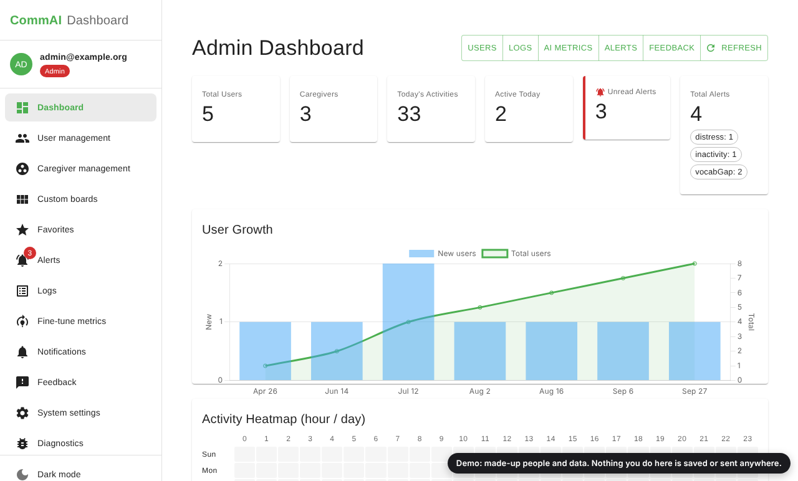

# Voice caregiver dashboard

A web dashboard for the people who support users of [Voice](https://github.com/mcneillium/ai-powered-aac-app), an AAC app for people who can't rely on speech. Caregivers can see how someone is communicating, manage their boards and favourites, and respond to alerts. Admins manage users, caregivers and system settings.

**[Try the demo](https://paulmartinmcneill.com/demos/aac-dashboard/#/admin)** (made-up people and data; nothing is saved) · **[Case study](https://paulmartinmcneill.com/projects/ai-aac-app/)**



## What it does

**For caregivers**
- **My users:** connect to a Voice user and see their recent activity.
- **Logs:** what was said and when, with filters and CSV export.
- **Custom boards:** build and edit boards for a user.
- **Favourites:** see the phrases a user has saved.
- **Alerts:** distress, inactivity and vocabulary-gap alerts, with unread counts.

**For admins**
- Counts of users, caregivers, today's activity and alerts. Charts of user growth and an hour-by-day activity heatmap.
- User and caregiver management, role-based access, feedback review and system settings.

## Built with

React 18 (Create React App with CRACO), Material UI, Chart.js and React Router, on Firebase Authentication, Realtime Database and Cloud Functions.

## Status

Version 0.2.0 is a working prototype, not a production service. Known gaps:
- **Log layout.** The dashboard reads activity logs in an older layout than the current app writes. The fix is in draft pull request #3.
- **Alerts and favourites.** These pages work, but the app doesn't feed them yet.
- **Database rules.** The shared rules need a caregiver read tier before they can be deployed. [docs/DATA-CONTRACT.md](docs/DATA-CONTRACT.md) lists every database path and who reads and writes it.

## Run it

You need Node 22 and npm.

```bash
git clone https://github.com/mcneillium/ai-powered-aac-dashboard.git
cd ai-powered-aac-dashboard
npm ci
npm start               # http://localhost:3000
```

Firebase settings are read in [`src/firebaseConfig.js`](src/firebaseConfig.js). Point them at your own Firebase project.

## Tests

```bash
npx craco test --watchAll=false
```

There are 19 tests, covering the shared data schema, login and app start-up. GitHub Actions runs them and a production build on every push.

## History

The original Create React App README is kept at [docs/archive/README-CRA.md](docs/archive/README-CRA.md), with two old patch files that used to sit at the top level of the repository.
